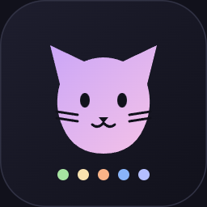
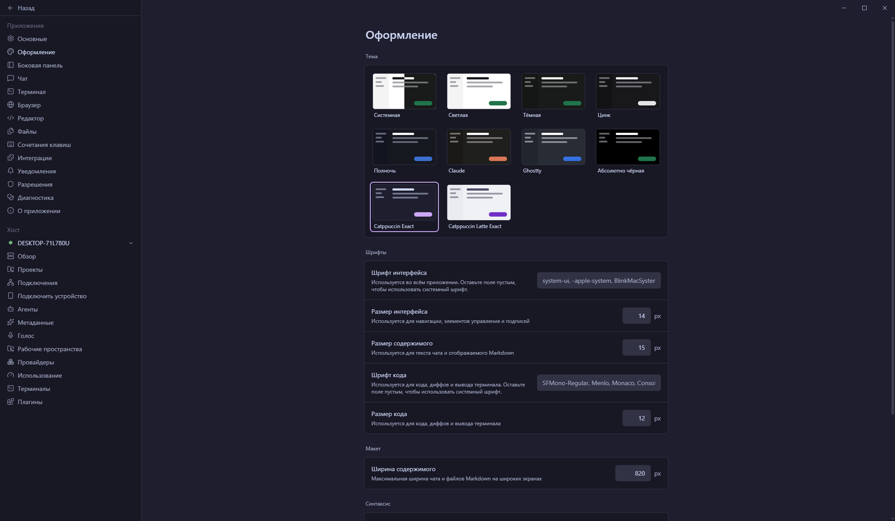

<div align="center">



# Catppuccin Exact for Paseo

**Catppuccin for Paseo — with the sidebar surface Paseo normally tints from the canvas.**

<p>
  <a href="#install"></a>
  <a href="https://github.com/catppuccin/catppuccin"></a>
  
</p>

<a href="#install">Install</a> ·
<a href="#why-exact">Why “Exact”</a> ·
<a href="#palette">Palette</a> ·
<a href="#publishing">Publishing</a> ·
<a href="#validation">Validation</a>

</div>

<picture>
  <source media="(prefers-color-scheme: dark)" srcset="assets/screenshot-dark.png">
  <source media="(prefers-color-scheme: light)" srcset="assets/screenshot-light.png">
  
</picture>

<div align="center"><sub><b>Dark:</b> Catppuccin Exact &nbsp;·&nbsp; <b>Light:</b> Catppuccin Latte Exact</sub></div>

---

A theme pair for [Paseo](https://paseo.sh) that carries the Catppuccin colors one-to-one:
canvas, sidebar, panels, controls, text and accent. The plugin is **client-only** — two palettes
and one scoped style override. No daemon entry, no network calls, no files touched.

- **Two themes** — a dark Mocha flavour and a light Latte flavour, both selectable in
  **Settings → Appearance**.
- **Exact surfaces** — the workspace tabs row and sidebar keep `#181825` in dark and `#e6e9ef`
  in light, instead of the color Paseo derives from the palette.
- **Palette data only** — Paseo expands the eight colors into panels, menus, diffs, status
  colors and the terminal; syntax highlighting keeps its own theme.
- **No settings** — the only choice is the theme itself.

## Why “Exact”

Paseo derives a contributed theme's sidebar from the palette instead of taking it as a color:
`background` in dark themes, `control` in light ones. With this palette the dark sidebar would
become `#1e1e2e` and the light one `#e9ebef`. The theme API has no sidebar field, so this
repository ships a small, reversible override in the client entry.

| Surface | Catppuccin Exact | Catppuccin Latte Exact |
| --- | --- | --- |
| Canvas | `#1e1e2e` | `#eff1f5` |
| Sidebar | **`#181825`** (derived: `#1e1e2e`) | **`#e6e9ef`** (derived: `#e9ebef`) |
| Raised panels | `#181825` | `#e6e9ef` |
| Controls | `#313244` | `#e9ebef` |
| Borders | `#313244` | `#bcc0cc` |

`index.client.tsx` appends one `<style>` element that sets `--colors-surface-sidebar` under
`html:root.pluginDark` and `html:root.pluginLight`, and repaints the workspace tabs row from that
variable. The element is removed by the contribution cleanup when the plugin stops. On native
clients `document` is undefined, the override is skipped, and Paseo's derived sidebar color stays
in place.

## Install

Paseo `0.15.3` or newer reads the manifest directly.

**1 · Install the plugin**

```sh
# from GitHub (replace <owner> with the repository owner)
paseo plugin add git:<owner>/paseo-catppuccin-exact

# or from a checkout
paseo plugin install /absolute/path/to/paseo-catppuccin-exact
```

**2 · Pick the themes** in **Settings → Appearance**:

| Mode | Theme |
| --- | --- |
| Dark | **Catppuccin Exact** |
| Light | **Catppuccin Latte Exact** |

**3 · Done.** Choosing a theme persists across restarts. Check that it loaded:

```sh
paseo plugin ls
# catppuccin-exact   running   yes   ...
```

Reload after source edits. Git and registry installs update with `paseo plugin update`;
remove any install with `paseo plugin remove`:

```sh
paseo plugin reload catppuccin-exact
paseo plugin update catppuccin-exact
paseo plugin remove catppuccin-exact
```

The plugin is not in the registry yet; see [Publishing](#publishing).

## Palette

The eight values `addTheme` accepts for each theme:

| Token | Catppuccin Exact | Catppuccin Latte Exact |
| --- | --- | --- |
| `background` | `#1e1e2e` | `#eff1f5` |
| `foreground` | `#cdd6f4` | `#4c4f69` |
| `raised` | `#181825` | `#e6e9ef` |
| `control` | `#313244` | `#e9ebef` |
| `border` | `#313244` | `#bcc0cc` |
| `accent` | `#cba6f7` | `#7130c7` |
| `mutedForeground` | `#a6adc8` | `#616274` |
| `ring` | `#6c7086` | `#8839ef` |

## Validation

```sh
npm run typecheck
npm pack --dry-run --ignore-scripts
paseo plugin reload catppuccin-exact && paseo plugin ls
```

| Check | Result |
| --- | --- |
| TypeScript | `tsc --noEmit`, no errors |
| Package contents | manifest, client entry, overview, README, icon, two screenshots |
| Plugin status | `running`, no load error |
| Screenshot colors | canvas `#1e1e2e` / `#eff1f5`, settings rail `#181825` / `#e6e9ef` |
| Native clients | no DOM override; Paseo's derived sidebar color |

## Repository layout

| Path | What it is |
| --- | --- |
| `index.client.tsx` | both palettes and the web sidebar override |
| `paseo-plugin.json` | manifest: ID, description, icon, media, Paseo requirement |
| `OVERVIEW.md` | listing text shown in the plugin registry |
| `assets/` | plugin icon and both screenshots |
| `README.md` | this file |

## Publishing

The listing uses the manifest and `OVERVIEW.md`; the registry pins a commit, so every version
bump needs the overview in the same commit. To submit this plugin:

1. **Push the repository** to a public GitHub repository.
2. **Add `repository`** to `package.json` with the public URL. npm listing ownership requires it;
   a Git listing works without it.
3. **Keep the screenshots** in `media`. A visual plugin needs at least one interface image, and
   the first image is the card thumbnail.
4. **Open the registry submission form** at
   [github.com/getpaseo/plugins/issues/new](https://github.com/getpaseo/plugins/issues/new?template=submit-plugin.yml)
   with the repository URL and the Themes category.

`OVERVIEW.md` must not contain install commands: the publication validator rejects them there.
Keep installation instructions in this README.

## Credits

Unofficial port of [Catppuccin](https://github.com/catppuccin/catppuccin) for
[Paseo](https://paseo.sh). Palette colors © the Catppuccin contributors. Not affiliated with or
endorsed by either project.
